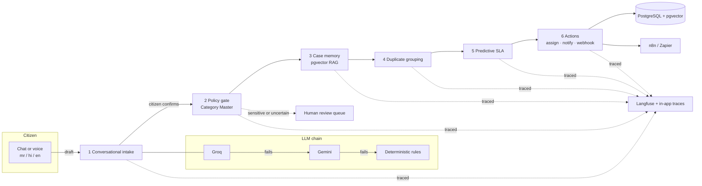

<div align="center">


**Agentic AI for intelligent grievance redressal**<br/>
HackFusion 4.0 · Agentic AI track

</div>

GRIEVANCE turns a submit-and-wait complaint portal into a system that behaves like an experienced grievance
officer. A citizen describes a problem in Marathi, Hindi or English, by text or voice. Six cooperating agents
turn it into a structured, confirmed grievance, route it to the right department, recall similar past cases,
link duplicate reports, predict delays before they happen and carry out the backend actions. People stay in
control wherever the risk or uncertainty is high.

> **Data notice.** The official HackFusion Category Master, Mock Grievance History and Department Directory have
> not been released. The agents therefore run on clearly labelled **synthetic** versions of those three datasets
> (generated, not official). Real public grievance data from Bengaluru (BBMP, 1.23 million records) is imported
> separately as labelled reference data. See [Data and provenance](#data-and-provenance).

---

## Contents

1. [How the problem statement is met](#how-the-problem-statement-is-met)
2. [Architecture](#architecture)
3. [Quick start](#quick-start)
4. [Mock API](#mock-api)
5. [Observability and the live trace link](#observability-and-the-live-trace-link)
6. [Data and provenance](#data-and-provenance)
7. [Security, privacy and responsible AI](#security-privacy-and-responsible-ai)
8. [Accessibility and inclusion](#accessibility-and-inclusion)
9. [Testing](#testing)
10. [Configuration](#configuration)
11. [Project structure](#project-structure)
12. [Known limitations](#known-limitations)

---

## How the problem statement is met

| Capability required | What GRIEVANCE does | Where |
|---|---|---|
| **1. Conversational intake** (text and voice; Marathi, Hindi, English; structured draft) | A chat assistant asks for missing facts (what, where, since when) in the citizen's language, then produces a structured draft: category, department, ward, urgency, SLA and summary. Voice is transcribed by Whisper and shown for editing before it is sent. Nothing is filed until the citizen ticks a confirmation and submits. | `backend/app/agents/conversation.py`, `intake.py` |
| **2. Safety and policy enforcement** (Category Master is the source of truth; sensitive cases never auto-closed) | A deterministic policy gate reads the Category Master for department, SLA, sensitivity, identity hiding and confidence threshold. Sensitive, low-confidence, prompt-injection or sensitive-keyword cases go to human review. The lifecycle service refuses any attempt by `AI_SYSTEM` to close a sensitive case, and there is no rejection status at all. | `agents/policy.py`, `services/grievances.py` |
| **3. Case memory (RAG)** | Local multilingual embeddings (`paraphrase-multilingual-MiniLM-L12-v2`) and pgvector cosine search retrieve the most similar resolved cases from the grievance history, widening from category to department to all. Officers see them as evidence with source IDs and similarity. | `agents/rag.py` |
| **4. Duplicate detection and incident grouping** (semantic, geographic, time; no silent drops) | Score = 0.55 semantic + 0.20 distance + 0.15 time + 0.10 category. Matches are linked into a group; every report keeps its own ID, status, notifications and audit trail. Officers can unlink. Works across languages (a Hindi and an English report of the same overflow linked at semantic 0.82). | `agents/duplicate.py` |
| **5. Predictive intelligence** (SLA breach and recurrence, before the delay) | Predicts resolution time and breach probability from historical resolution times and current department load, warns at 75% of the SLA or when the risk is high, escalates breaches, and finds recurring category-and-ward hotspots and department bottlenecks. | `agents/predictive.py` |
| **6. Real-world action** (mock DB updates, department assignment, n8n/Zapier webhooks) | Assigns the department and least-loaded ward officer, updates status, notifies people, and sends HMAC-signed webhooks compatible with n8n and Zapier. A built-in mock receiver lets you demonstrate delivery without external services. | `agents/actions.py`, `services/webhooks.py`, `api/mock.py` |
| **Observability** (Langfuse live tracing; inspectable reasoning) | Every workflow is traced step by step with model, inputs, outputs, RAG evidence, policy decision, confidence, actions, errors and timing. Each step records a structured decision trail. Traces are exported to Langfuse as public traces, and can also be shared as redacted links from the app. | `services/tracing.py` |

**Rubric coverage.** Real-world understanding: grounded in 1.23M real BBMP grievances (volume, categories, channels, statuses). Technical quality: 80 automated backend tests and 10 frontend tests, and a PostgreSQL/pgvector stack in Docker. Responsible AI: policy gate, human review, audit log, PII redaction. Accessibility: three languages, voice in and read-aloud out, keyboard and screen-reader support. Observability: Langfuse export and an in-app trace explorer.

---

## Architecture



- **Backend:** FastAPI, SQLAlchemy 2, Alembic, PostgreSQL 16 with pgvector (SQLite supported for quick local runs and tests).
- **LLM chain:** Groq first, Gemini when Groq fails or returns invalid output, deterministic multilingual rules when neither is available. LLM output is schema-validated, cross-checked against the rules and passed through the policy gate. The system works fully with no keys.
- **Frontend:** React, Vite, TypeScript, Tailwind; citizen, officer and administrator views.

Grievance lifecycle: `SUBMITTED → PENDING_REVIEW | ASSIGNED → IN_PROGRESS → RESOLVED → CLOSED`, and
`RESOLVED / CLOSED → REOPENED` when a citizen disputes the fix. Every transition goes through one service that
enforces the safety rules.

---

## Quick start

### With Docker (PostgreSQL + pgvector, recommended)

```bash
cp backend/.env.example backend/.env        # then set JWT_SECRET; optional: GROQ/GEMINI/LANGFUSE keys
docker compose up --build -d
```

On Windows with Docker Compose v5 + Buildx 0.38, `compose up --build` can stop with
`additional privileges requested: pass "--allow=fs.read=..."`. Build the images directly, then start:

```bash
docker build -t grievance-backend ./backend
docker build -t grievance-frontend ./frontend
docker compose up -d
```

| Service | URL |
|---|---|
| Web app | http://localhost:8080 |
| API docs (Swagger) | http://localhost:8000/api/v1/docs |
| PostgreSQL | localhost:5432 (grievance / grievance) |

The backend migrates and seeds the synthetic datasets on start (about a minute the first time). To add the
real BBMP data: `docker compose exec backend python -m app.cli external fetch` then
`... external import` (about 6 minutes).

### Without Docker

**Backend** (Python 3.10+):

```bash
cd backend
python -m venv .venv && .venv\Scripts\activate          # macOS/Linux: source .venv/bin/activate
pip install -r requirements.txt
pip install -r requirements-ml.txt                        # optional: multilingual embeddings + Whisper voice
cp .env.example .env                                      # DATABASE_URL=sqlite:///./grievance.db works out of the box
python -m app.cli init                                    # migrate + synthetic datasets + demo accounts
python -m app.cli external fetch && python -m app.cli external import   # optional: real BBMP data
uvicorn app.main:app --reload --port 8000
```

**Frontend** (Node 20+):

```bash
cd frontend
cp .env.example .env
npm install
npm run dev                                               # http://localhost:5173
```

**Demo accounts** (synthetic, development only; password `Demo@12345`):

| Role | E-mail |
|---|---|
| Citizen | `citizen@example.org` |
| Officer, Water Supply | `officer.water@example.org` |
| Officer, Women and Child Safety (sensitive cases) | `officer.safety@example.org` |
| Administrator | `admin@example.org` |

---

## Mock API

All endpoints are under `/api/v1`. Interactive documentation: **`/api/v1/docs`** (Swagger) and **`/api/v1/redoc`**.
Authentication is a bearer JWT from `/auth/login`. The examples below were captured from a running instance
in rule-based mode (no LLM keys).

### Endpoint reference

| Method | Path | Role | Purpose |
|---|---|---|---|
| POST | `/auth/register` · `/auth/login` | public | Create a citizen account · obtain a JWT |
| GET | `/auth/me` | any | Current user |
| GET | `/meta/categories` · `/meta/wards` · `/meta/status` | public | Category Master, wards, live system capabilities |
| POST | `/citizen/intake/converse` | citizen | **Conversational intake**: one chat turn; returns a follow-up question or a draft |
| POST | `/citizen/intake/transcribe` | citizen | Whisper speech-to-text (audio is not stored) |
| POST | `/citizen/intake/{token}/confirm` | citizen | **Explicit confirmation**: creates the grievance and runs the six-agent pipeline |
| GET | `/citizen/grievances` · `/citizen/grievances/{id}` | citizen | Track own grievances and status history |
| POST | `/citizen/grievances/{id}/confirm-resolution` · `/dispute` | citizen | Close with rating, or dispute to reopen |
| GET | `/officer/queue` · `/officer/stats` | officer, admin | Work queues (mine, department, human review) |
| GET | `/officer/grievances/{id}` | officer, admin | Workspace: AI summary, policy decision and reasoning, precedents, duplicates, SLA, audit |
| POST | `/officer/grievances/{id}/review` · `/status` · `/notes` · `/reassign` · `/escalate` | officer, admin | Human decisions and backend actions |
| POST | `/officer/grievances/{id}/duplicates/{other}/unlink` | officer, admin | Remove an incorrect duplicate link |
| GET/PATCH | `/admin/categories` · `/admin/officers` · `/admin/departments` | admin | Category Master and directory |
| POST | `/admin/datasets/import` | admin | Import CSV/XLSX (dry run first) for the HackFusion datasets |
| GET/POST | `/admin/webhooks` · `/admin/webhooks/{id}/test` | admin | Register n8n/Zapier webhooks and send a signed test event |
| POST/GET | `/mock/webhook-receiver` | public POST, admin GET | Built-in stand-in for an n8n or Zapier trigger; verifies the signature |
| POST | `/admin/jobs/sla-scan` · `/admin/jobs/auto-close` | admin | Run the SLA monitor or auto-close now |
| GET | `/analytics/*` | admin | Overview, trends, SLA, recurrence, bottlenecks, agent activity, page views |
| GET | `/observability/traces` · `/traces/{id}` · `/langfuse` | admin | Traces, step detail, Langfuse connection check |
| POST | `/observability/traces/{id}/share` | admin | Create a redacted public link |
| GET | `/public/traces/{token}` | public | Redacted shared trace |
| GET | `/external/datasets` · `/external/bbmp/summary` · `/external/bbmp/records` | officer, admin | Real public data: provenance, statistics, record explorer |

### Example: a conversational intake in Hindi

**1. The citizen writes without saying where.**

```http
POST /api/v1/citizen/intake/converse
Authorization: Bearer <citizen token>

{ "messages": [ { "role": "user", "content": "सीवर का पानी सड़क पर बह रहा है" } ], "language": "hi" }
```

```json
{
  "reply": "कृपया समस्या थोड़ा विस्तार से बताएं। क्या हो रहा है और कौन प्रभावित है?",
  "ready": false,
  "language": "hi",
  "missing": ["details", "location", "duration"],
  "trace_id": "…",
  "draft": null
}
```

**2. Once the place and timing are known, the assistant returns a draft** (excerpt of a real response):

```json
{
  "ready": true,
  "draft": {
    "draft_token": "eZ3SeRdA_6mL…",
    "extraction": {
      "language": "hi",
      "category_code": "SEWAGE",
      "category_confidence": 0.856,
      "urgency": "high",
      "ward": "Ward 11",
      "location_text": "Ganesh Peth, Ward 11",
      "department": { "code": "DRAIN", "name": "Drainage & Sewerage" },
      "policy_preview": { "requires_human_review": false, "is_sensitive": false, "sla_hours": 24 },
      "provider": "deterministic-rules",
      "method": "rules"
    }
  }
}
```

**3. The citizen confirms.** Without `"confirmed": true` the API answers `409 policy_violation`.

```http
POST /api/v1/citizen/intake/eZ3SeRdA_6mL…/confirm

{ "confirmed": true }
```

```json
{
  "public_id": "GRV-2026-461365",
  "status": "ASSIGNED",
  "category": { "code": "SEWAGE", "name_en": "Sewage overflow", "name_hi": "सीवर ओवरफ्लो", "name_mr": "सांडपाणी वाहणे" },
  "department": { "code": "DRAIN", "name": "Drainage & Sewerage" },
  "urgency": "high",
  "needs_human_review": false,
  "sla": {
    "due_at": "2026-11-12T11:49:54+00:00",
    "sla_hours": 24,
    "predicted_resolution_hours": 17.9,
    "breach_probability": 0.185,
    "estimate_label": "Demo estimate based on SYNTHETIC history, not a measure of real-world accuracy."
  }
}
```

**4. What the officer sees** (`GET /officer/grievances/GRV-2026-461365`, excerpt):

```json
{
  "precedents": [
    { "rank": 1, "public_id": "SYN-H-00544", "similarity": 0.8092, "scope": "category",
      "summary": "SYN-H-00544 (Ward 11, resolved in 1.5 days): Choked sewer line cleared and manhole cover replaced; area disinfected.",
      "data_source": "SYNTHETIC" }
  ],
  "duplicates": [
    { "public_id": "GRV-2026-495826", "score": 0.9, "linked_by": "AI_SYSTEM",
      "signals": { "semantic": 0.82, "geo": 1.0, "time": 0.993, "category": 1.0, "distance_km": 0.0 } }
  ],
  "policy_explanation": {
    "policy_refs": ["POL-AUTOCLOSE-01", "POL-LIABILITY-01", "POL-NOREJECT-01", "POL-SLA-01"],
    "reasoning": [
      "Category Master entry SEWAGE: department DRAIN, SLA 24 h, sensitive=False, identity hiding=False, threshold 0.70",
      "POL-SENSITIVE-01 sensitive category: no",
      "POL-CONF-01 confidence 0.86 vs threshold 0.70: pass",
      "POL-INJECT-01 instruction-like text: none"
    ]
  }
}
```

### Webhook payload (n8n / Zapier)

```http
POST <your webhook URL>
Content-Type: application/json
X-Grievance-Event: grievance.assigned
X-Grievance-Signature: sha256=<HMAC-SHA256 of the raw body with WEBHOOK_SIGNING_SECRET>

{
  "event": "grievance.assigned",
  "data": { "grievance_id": "GRV-2026-461365", "status": "ASSIGNED", "category": "SEWAGE", "department": "DRAIN",
            "urgency": "high", "ward": "Ward 11", "is_sensitive": false, "escalation_level": 0,
            "sla_due_at": "2026-11-12T11:49:54+00:00", "data_source": "LIVE" },
  "sent_at": "2026-11-11T11:49:55+00:00"
}
```

Events: `grievance.created`, `grievance.assigned`, `grievance.review_required`, `grievance.status_changed`,
`grievance.escalated`, `grievance.sla_at_risk`, `grievance.duplicate_linked`, `grievance.reopened`,
`webhook.test`. Payloads never contain complaint text or citizen identity.

---

## Observability and the live trace link

Each workflow (`intake_conversation`, `intake_analysis`, `grievance_pipeline`, `sla_scan`, `auto_close`) is
recorded step by step: agent, provider and model, inputs (PII-redacted), structured output, retrieved evidence,
confidence, timing, errors and a **decision trail**. Each trail lists what the agent saw, which rule or score it
applied and what it decided. The trail is a structured explanation, not raw model chain-of-thought.

- **In the app:** Admin → Observability lists traces and shows every step. *Create public link* produces a
  redacted page at `/share/trace/<token>`. It leaves out complaint text, place names and identities.
- **In Langfuse:** with keys configured, every trace is exported as a public Langfuse trace (one span per agent,
  LLM calls as generations). The app reads your Langfuse project ID through the API and shows the real link.
  It never constructs a URL it cannot verify.

**To produce the live trace link for submission:**

1. Create a free project at https://cloud.langfuse.com (or https://us.cloud.langfuse.com).
2. Project settings → API keys → create a key pair.
3. In `backend/.env` set `LANGFUSE_HOST`, `LANGFUSE_PUBLIC_KEY` and `LANGFUSE_SECRET_KEY`, then restart the backend.
4. Admin → Observability should show *Langfuse connected*. File a grievance, open its trace and use
   *Open in Langfuse*. That page is publicly viewable.

> Status in this repository: the export is implemented and tested against a mocked Langfuse API. It has not
> been run against a live Langfuse project because no keys were available while building.

---

## Data and provenance

| Dataset | Status | Used by the agents | Licence |
|---|---|---|---|
| HackFusion Category Master, Mock Grievance History, Department Directory | **Synthetic** stand-ins (`backend/data/synthetic/`, generated by `scripts/generate_synthetic_data.py`) until the official files are released | Yes | Generated for this project |
| BBMP Sahaaya 2.0 citizen grievances (Vonter) | **Imported:** 1,230,890 real records, Feb 2020 to Aug 2026 | No. Reference statistics and record explorer only | ODbL v1.0 |
| BBMP Grievances Data 2025 (OpenCity) | Downloaded; used to verify the import (all 126,974 IDs matched) | No | Other (Public Domain) |
| data.gov.in CPGRAM: monthly receipts and disposals; nodal officer directory | Not downloaded: the OGD API requires a personal API key (`DATA_GOV_IN_API_KEY`) | No | Government Open Data License - India |
| CPGRAMS individual grievances | Not accessible: available only to authorised users on pgportal.gov.in | No | |

The real BBMP records contain **no complaint text written by citizens** and **no resolution dates**, so they are
not used for RAG, duplicate detection or SLA training. Staff names are not imported, and phone numbers, e-mail
addresses, long ID numbers and named individuals in staff remarks are redacted. Missing values stay empty and
are never invented. Full details, including checksums and every transformation: **[backend/data/external/PROVENANCE.md](backend/data/external/PROVENANCE.md)**.

**Attribution:** Contains information from bbmp-citizen-grievances (github.com/Vonter/bbmp-citizen-grievances),
made available under the ODbL v1.0. Some individual contents are under copyright by BBMP.

Official HackFusion datasets, when released, are imported through Admin → Datasets or
`python -m app.cli import <kind> <file> --official` using the column maps in `backend/data/schemas/`. They are
tagged `OFFICIAL` and never silently overwrite synthetic records. The synthetic-data banner disappears once no
synthetic data remains in use.

---

## Security, privacy and responsible AI

- **Human oversight:** sensitive categories (harassment, child safety, corruption), low confidence, instruction-like text and sensitive keywords in other categories all route to human review. Only authorised officers see sensitive cases.
- **Hard limits in code:** the AI cannot close sensitive grievances, cannot release a case from review, cannot reject (there is no rejected status) and makes no liability findings. Each is covered by tests.
- **Untrusted input:** complaint text is placed only inside delimited data blocks in the LLM user turn, never in instructions; LLM output is schema-validated and cross-checked.
- **Audit:** every AI action writes an `AI_SYSTEM` audit event with provider, model, confidence, explanation, policy references and trace ID.
- **Privacy:** identity masking for officers, full identity hiding for sensitive categories, PII redaction in traces, audit explanations and shared links, voice recordings deleted after transcription, consent-based anonymous page analytics with no cookies or third parties.
- **Application security:** JWT auth, role and object-level authorization, bcrypt, input validation, rate limits, a registration honeypot, daily submission caps, security headers, a strict Content-Security-Policy (no `unsafe-eval`), optional HTTPS redirect and HSTS behind a TLS proxy, and secrets only in `backend/.env`.

## Accessibility and inclusion

Marathi, Hindi and English throughout the citizen journey; voice input (Whisper) with an editable transcript;
read-aloud of the draft and the grievance in the citizen's language; keyboard navigation, visible focus, skip
link, labelled controls and status conveyed in text, not colour alone; layouts verified at 390, 820 and 1440
pixels wide.

---

## Testing

```bash
cd backend && python -m pytest -q          # 80 tests
cd frontend && npm run lint && npm run typecheck && npm test && npm run build   # 10 tests
```

Backend tests run on a temporary SQLite database with no LLM keys (fallback mode). They cover the twelve
mandated scenarios (submission with confirmation, tracking, sensitive review, sensitive never auto-closed,
low-confidence review, duplicates preserving records, RAG relevance, SLA warnings, dispute and reopen,
unauthorized access, AI audit events, missing-credential fallback) plus conversational intake, decision trails,
Langfuse export (mocked), webhook signatures, the BBMP importer and redaction, and the security headers.

## Configuration

`backend/.env` (see `.env.example` for every key): `DATABASE_URL`, `JWT_SECRET`, `CORS_ORIGINS`,
`GROQ_API_KEY` / `GROQ_MODEL`, `GEMINI_API_KEY` / `GEMINI_MODEL`, `EMBEDDING_PROVIDER`, `STT_PROVIDER` /
`WHISPER_MODEL`, policy thresholds, `LANGFUSE_*`, `WEBHOOK_SIGNING_SECRET`, `DATA_GOV_IN_API_KEY`,
`MAX_GRIEVANCES_PER_DAY`, `ENFORCE_HTTPS`.

`frontend/.env` holds public values only: `VITE_API_BASE_URL`, `VITE_SITE_URL`, `VITE_SUPPORT_EMAIL`.

## Project structure

```text
GRIEVANCE/
├── backend/
│   ├── app/
│   │   ├── agents/      intake, conversation, policy, rag, duplicate, predictive, actions, orchestrator
│   │   ├── api/         auth, meta, citizen, officer, admin, analytics, observability, external, mock
│   │   ├── llm/         Groq → Gemini → rules client, embeddings, Whisper
│   │   ├── services/    lifecycle, audit, notifications, webhooks, tracing, importer, external data, seed
│   │   └── models/ core/ db/ schemas/
│   ├── alembic/         migrations (PostgreSQL + pgvector, SQLite)
│   ├── data/            synthetic/, schemas/, external/ (PROVENANCE.md; raw downloads git-ignored)
│   ├── tests/
│   └── .env.example, requirements.txt, requirements-ml.txt, Dockerfile
├── frontend/
│   ├── src/             pages (public, citizen, officer, admin), components, lib
│   ├── public/          brand assets, icons, manifest
│   └── .env.example, nginx/, Dockerfile
├── docker-compose.yml
├── .gitignore
└── README.md
```

## Known limitations

- The agents use synthetic stand-ins for the three HackFusion datasets until the official files are released; SLA figures are demo estimates.
- Without Groq or Gemini keys, intake uses the rule engine, which is reliable for clear complaints and deliberately sends vague ones to human review.
- The Langfuse export has been verified against a mocked API only; a live link needs your Langfuse keys.
- data.gov.in CPGRAM statistics need a personal OGD API key; the fetcher has not been run against the live API.
- Updates are delivered in the app; SMS and WhatsApp are planned and can be connected through webhooks.
- The Docker image excludes the large ML models by default (`--build-arg INSTALL_ML=true` adds multilingual embeddings and Whisper).
