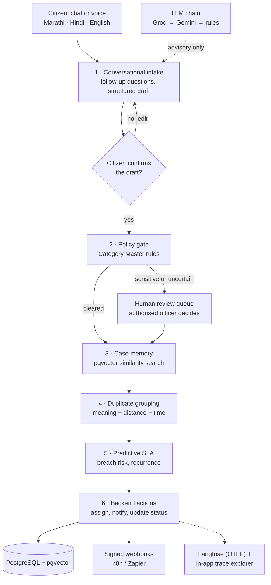

<div align="center">


### Agentic AI for intelligent, multilingual grievance redressal

Report a civic problem in Marathi, Hindi or English, by text or voice. Six cooperating agents turn it into a
confirmed grievance, route it, recall similar past cases, link duplicates, predict delays and act, with people in
control wherever the risk is high.


-0A0A0A)


**HackFusion 4.0 · Agentic AI Track**

[Live Langfuse trace](https://cloud.langfuse.com/project/cmwddgyt3008uad0e2t2el0qk/traces/fa111f858a7b4ee8b3ff626e4a483d4a) ·
[Mock API](#api-reference) ·
[Quick start](#quick-start) ·
[Architecture](#architecture)

</div>

---

## Table of contents

1. [Overview](#overview)
2. [How the problem statement is met](#how-the-problem-statement-is-met)
3. [Architecture](#architecture)
4. [Role-based dashboards](#role-based-dashboards)
5. [Quick start](#quick-start)
6. [Accounts and access](#accounts-and-access)
7. [API reference](#api-reference)
8. [Observability and the live trace](#observability-and-the-live-trace)
9. [Data and provenance](#data-and-provenance)
10. [Security, privacy and responsible AI](#security-privacy-and-responsible-ai)
11. [Accessibility and inclusion](#accessibility-and-inclusion)
12. [Testing](#testing)
13. [Configuration](#configuration)
14. [Project structure](#project-structure)
15. [Known limitations](#known-limitations)
16. [Author](#author)

---

## Overview

Most grievance portals are *submit and wait*: a form disappears into a queue and the citizen hears nothing.
GRIEVANCE behaves like an experienced grievance officer instead. It understands a complaint in the citizen's
language, asks for what is missing, checks it against the Category Master, consults similar resolved cases,
recognises repeat reports of the same incident, forecasts whether the deadline will slip, and carries out the
routine backend work, while sending anything sensitive or uncertain to a person.

| | |
| --- | --- |
| **Who it serves** | Citizens, grievance officers, department administrators and system administrators, each with their own dashboard |
| **Languages** | Marathi, Hindi and English, typed or spoken |
| **AI approach** | Language models suggest; a deterministic policy gate and officers decide |
| **Runs without keys** | Yes. With no LLM keys the system falls back to multilingual rules |
| **Traceability** | Every workflow is traced step by step in the app and in Langfuse |

> **Data notice.** The official HackFusion Category Master, Mock Grievance History and Department Directory have
> not been released. The agents run on clearly labelled **synthetic** versions of those three datasets. Real
> public grievance data from Bengaluru (BBMP, 1.23 million records) is imported separately as labelled reference
> data. See [Data and provenance](#data-and-provenance).

---

## How the problem statement is met

| Required capability | What GRIEVANCE does | Code |
| --- | --- | --- |
| **1. Conversational intake** — text and voice in Marathi, Hindi, English; structured draft | A chat assistant asks for missing facts (what, where, since when) in the citizen's language and produces a structured draft: category, department, ward, urgency, SLA and summary. Voice uses server-side Whisper when installed and the browser's speech recognition otherwise; the transcript is always editable. Nothing is filed until the citizen explicitly confirms. | `agents/conversation.py`, `agents/intake.py` |
| **2. Safety and policy enforcement** — Category Master is the source of truth; sensitive cases never auto-closed | A deterministic policy gate reads the Category Master for department, SLA, sensitivity, identity hiding and confidence threshold. Sensitive, low-confidence, prompt-injection and sensitive-keyword cases go to human review. The lifecycle service refuses any attempt by `AI_SYSTEM` to close a sensitive case, and there is no rejection status at all. | `agents/policy.py`, `services/grievances.py` |
| **3. Case memory (RAG)** | Multilingual embeddings (`paraphrase-multilingual-MiniLM-L12-v2`) and pgvector cosine search retrieve the most similar resolved cases, widening from category to department to all. Officers see them as evidence with source IDs and similarity scores. | `agents/rag.py` |
| **4. Duplicate detection and incident grouping** — semantic, geographic, time; no silent drops | Score = 0.55 semantic + 0.20 distance + 0.15 time + 0.10 category. Matches are *linked*, never merged: every report keeps its own ID, status, notifications and audit trail, and officers can unlink a wrong match. Works across languages. | `agents/duplicate.py` |
| **5. Predictive intelligence** — SLA breach and recurrence, before the delay | Predicts resolution time and breach probability from historical resolution times and current department load, warns at 75% of the SLA or on high risk, escalates breaches, and surfaces recurring category-and-ward hotspots and department bottlenecks. | `agents/predictive.py` |
| **6. Real-world action** — DB updates, department assignment, n8n/Zapier webhooks | Assigns the department and the least-loaded ward officer, updates status, notifies people, and sends HMAC-signed webhooks compatible with n8n and Zapier. A built-in mock receiver demonstrates delivery without external services. | `agents/actions.py`, `services/webhooks.py` |
| **Observability** — Langfuse live tracing; inspectable reasoning | Every workflow is exported to Langfuse over OpenTelemetry in real time, with typed observations (agent, generation, guardrail, retriever, tool), model and token usage, sessions per grievance and a structured decision trail at every step. | `services/tracing.py` |

### Evaluation rubric at a glance

| Criterion | Evidence |
| --- | --- |
| Real-world problem understanding (20%) | Grounded in 1.23M real BBMP grievances; covers the full lifecycle including disputes, reopening and escalation |
| Technical quality and working agentic implementation (20%) | Six agents behind one orchestrator, PostgreSQL + pgvector, 93 backend and 10 frontend tests |
| Innovation and appropriate AI use (15%) | LLMs are advisory; a rule-based policy gate and human review decide; cross-language duplicate linking |
| Feasibility and integration potential (15%) | Docker deployment, signed webhooks for n8n/Zapier, dataset importers for the official HackFusion files |
| Security, privacy and responsible AI (10%) | Role and object-level access control, identity hiding, PII redaction, full audit log, no auto-closure of sensitive cases |
| Accessibility and inclusion (10%) | Three languages, voice in and read-aloud out, keyboard and screen-reader support |
| Observability, traceability and demo quality (10%) | Live Langfuse traces plus an in-app trace explorer with shareable redacted links |

---

## Architecture



| Layer | Technology |
| --- | --- |
| Backend | FastAPI, SQLAlchemy 2, Alembic, PostgreSQL 16 with pgvector (SQLite for quick local runs and tests) |
| LLM chain | Groq (`openai/gpt-oss-120b`) → Gemini (`gemini-2.5-flash`) → deterministic multilingual rules. Output is schema-validated, cross-checked against the rules and passed through the policy gate |
| Speech and embeddings | faster-whisper for server-side transcription; sentence-transformers for multilingual embeddings |
| Frontend | React 18, Vite, TypeScript, Tailwind CSS |
| Observability | Langfuse via OpenTelemetry (OTLP/HTTP, real-time ingestion) |

**Grievance lifecycle:** `SUBMITTED → PENDING_REVIEW | ASSIGNED → IN_PROGRESS → RESOLVED → CLOSED`, and
`RESOLVED / CLOSED → REOPENED` when a citizen disputes the fix. Every transition goes through one service that
enforces the safety rules.

---

## Role-based dashboards

Every signed-in user gets the same application shell: a collapsible sidebar (a slide-out drawer on mobile),
breadcrumbs, grievance search, notifications with an unread count and a profile menu. The information
architecture differs by role, and the backend enforces each role's scope on every request.

| Role | Sidebar | Scope enforced by the API |
| --- | --- | --- |
| **Citizen** | My Dashboard · My Grievances · File a Grievance · Track Complaint · Notifications · My Profile · Help & Support | Only their own grievances |
| **Grievance Officer** | Overview · Assigned Cases · All Grievances · Review Queue · Escalations · SLA Monitoring · Duplicate Incidents · Reports & Analytics | Their assigned cases and their department; sensitive cases only when cleared |
| **Department Admin** | Department Overview · Department Grievances · Case Distribution · Assignment Management · Pending Approvals · Officers & Team · SLA Performance · Reports & Analytics | Every grievance and officer of their own department only |
| **System Admin** | Platform Overview · User Management · Departments · Category Master · Policy & Rules · SLA Configuration · Grievance Management · Audit Logs · AI & RAG Monitoring · Integrations & Webhooks · System Settings | The whole platform |

All roles also have **My Profile**: editable details (fields allowed per role, enforced server-side), password
change, notification preferences that are applied when notifications are created, and session sign-out.

---

## Quick start

### With Docker (recommended)

```bash
cp backend/.env.example backend/.env     # set JWT_SECRET; optionally GROQ / GEMINI / LANGFUSE keys
docker build -t grievance-backend  ./backend
docker build -t grievance-frontend ./frontend
docker compose up -d
```

| Service | URL |
| --- | --- |
| Web app | http://localhost:8080 |
| API documentation (Swagger) | http://localhost:8000/api/v1/docs |
| PostgreSQL | localhost:5432 |

The backend migrates and seeds the synthetic datasets on start. The image includes Whisper and multilingual
embeddings by default (`INSTALL_ML=true`); downloaded models persist in the `models` volume. Build with
`--build-arg INSTALL_ML=false` for a much smaller image that uses a hashing embedder and no server-side voice.

> If you switch embedding providers on an existing database, re-embed once:
> `docker compose exec backend python -m app.cli reembed`.
>
> On Windows, `docker compose up --build` may stop with `additional privileges requested`. Building the images
> with `docker build` as above avoids it.

**Real BBMP reference data** (optional, about six minutes):

```bash
docker compose exec backend python -m app.cli external fetch
docker compose exec backend python -m app.cli external import
```

### Without Docker

**Backend** (Python 3.10+)

```bash
cd backend
python -m venv .venv && .venv\Scripts\activate            # macOS/Linux: source .venv/bin/activate
pip install -r requirements.txt
pip install -r requirements-ml.txt                          # optional: multilingual embeddings + Whisper
cp .env.example .env                                        # SQLite works out of the box
python -m app.cli init                                      # migrate + synthetic datasets
uvicorn app.main:app --reload --port 8000
```

**Frontend** (Node 20+)

```bash
cd frontend
cp .env.example .env
npm install
npm run dev                                                 # http://localhost:5173
```

---

## Accounts and access

- **Citizens** register themselves and are signed in immediately.
- **Grievance officers** can request access from the registration page. The account stays inactive until a
  system administrator approves it in *User Management*.
- **Department administrators and system administrators** are created only by a system administrator.
- **The first system administrator** is created at start-up from `BOOTSTRAP_ADMIN_EMAIL`,
  `BOOTSTRAP_ADMIN_PASSWORD` and `BOOTSTRAP_ADMIN_NAME` in `backend/.env`. The password is used only when the
  account is first created.
- **Local demo users** are seeded only when `DEMO_PASSWORD` is set in `backend/.env`. No demo password is
  published. Set `SEED_DEMO_USERS=false` for any shared or public deployment.

---

## API reference

All endpoints are under `/api/v1`. Interactive documentation is served at **`/api/v1/docs`** (Swagger) and
**`/api/v1/redoc`**. Authentication is a bearer JWT from `/auth/login`.

### Authentication and profile

| Method | Path | Role | Purpose |
| --- | --- | --- | --- |
| POST | `/auth/register` | public | Citizen account, or an officer access request (inactive until approved) |
| POST | `/auth/login` | public | Obtain a JWT |
| GET / PATCH | `/auth/me` | any | Current profile; field-level edit permissions enforced per role |
| POST | `/auth/change-password` | any | Change password (current password required) |

### Citizen

| Method | Path | Purpose |
| --- | --- | --- |
| POST | `/citizen/intake/converse` | **Conversational intake**: one chat turn; returns a follow-up question or a draft |
| POST | `/citizen/intake/transcribe` | Whisper speech-to-text (audio is not stored) |
| POST | `/citizen/intake/{token}/confirm` | **Explicit confirmation**: creates the grievance and runs the six-agent pipeline |
| GET | `/citizen/grievances` · `/citizen/grievances/{id}` | Own grievances and full status history |
| POST | `/citizen/grievances/{id}/confirm-resolution` · `/dispute` | Close with a rating, or dispute to reopen |

### Officer, department admin and system admin

| Method | Path | Purpose |
| --- | --- | --- |
| GET | `/officer/queue` · `/officer/stats` · `/officer/activity` | Scoped case lists, live counts and recent status changes |
| GET | `/officer/grievances/{id}` | Case workspace: AI summary, policy decision, precedents, duplicates, SLA, audit |
| POST | `/officer/grievances/{id}/review` · `/status` · `/notes` · `/reassign` · `/escalate` | Human decisions and backend actions (all audited) |
| GET | `/officer/duplicates` | Linked incident groups with match evidence |
| GET | `/officer/reports` · `/officer/reports/export` | Scoped analytics and a CSV export with no citizen identity |
| GET / PATCH | `/department/summary` · `/department/officers` | Department admin: team, capacity and ward coverage |
| GET / POST / PATCH | `/admin/users` · `/admin/departments` · `/admin/categories` · `/admin/officers` | User, department and Category Master administration |
| GET | `/admin/settings` · `/admin/audit` | Read-only runtime settings (no secrets) and the audit log |
| POST | `/admin/datasets/import` | Import the HackFusion datasets from CSV or XLSX (dry run first) |
| GET / POST | `/admin/webhooks` · `/admin/webhooks/{id}/test` | Register n8n/Zapier webhooks and send a signed test event |
| POST | `/admin/jobs/sla-scan` · `/admin/jobs/auto-close` | Run the SLA monitor or auto-close on demand |
| GET | `/analytics/*` · `/observability/*` | Platform analytics, agent traces and the Langfuse connection check |

### Example: conversational intake in Hindi

**1. The citizen writes without saying where.**

```http
POST /api/v1/citizen/intake/converse
Authorization: Bearer <citizen token>

{ "messages": [ { "role": "user", "content": "सीवर का पानी सड़क पर बह रहा है" } ], "language": "hi" }
```

```json
{
  "reply": "कृपया समस्या थोड़ा विस्तार से बताएं। क्या हो रहा है और कौन प्रभावित है?",
  "ready": false,
  "language": "hi",
  "missing": ["details", "location", "duration"],
  "draft": null
}
```

**2. Once the place and timing are known, the assistant returns a draft** (excerpt):

```json
{
  "ready": true,
  "draft": {
    "draft_token": "eZ3SeRdA_6mL…",
    "extraction": {
      "language": "hi",
      "category_code": "SEWAGE",
      "category_confidence": 0.856,
      "urgency": "high",
      "ward": "Ward 11",
      "department": { "code": "DRAIN", "name": "Drainage & Sewerage" },
      "policy_preview": { "requires_human_review": false, "is_sensitive": false, "sla_hours": 24 }
    }
  }
}
```

**3. The citizen confirms.** Without `"confirmed": true` the API answers `409 policy_violation`.

```http
POST /api/v1/citizen/intake/eZ3SeRdA_6mL…/confirm

{ "confirmed": true }
```

```json
{
  "public_id": "GRV-2026-461365",
  "status": "ASSIGNED",
  "department": { "code": "DRAIN", "name": "Drainage & Sewerage" },
  "urgency": "high",
  "needs_human_review": false,
  "sla": { "sla_hours": 24, "predicted_resolution_hours": 17.9, "breach_probability": 0.185 }
}
```

**4. What the officer sees** (`GET /officer/grievances/GRV-2026-461365`, excerpt):

```json
{
  "precedents": [
    { "rank": 1, "public_id": "SYN-H-00544", "similarity": 0.8092, "scope": "category",
      "summary": "SYN-H-00544 (Ward 11, resolved in 1.5 days): Choked sewer line cleared and manhole cover replaced." }
  ],
  "duplicates": [
    { "public_id": "GRV-2026-495826", "score": 0.9, "linked_by": "AI_SYSTEM",
      "signals": { "semantic": 0.82, "geo": 1.0, "time": 0.993, "category": 1.0, "distance_km": 0.0 } }
  ],
  "policy_explanation": {
    "policy_refs": ["POL-AUTOCLOSE-01", "POL-LIABILITY-01", "POL-NOREJECT-01", "POL-SLA-01"],
    "reasoning": [
      "Category Master entry SEWAGE: department DRAIN, SLA 24 h, sensitive=False, threshold 0.70",
      "POL-CONF-01 confidence 0.86 vs threshold 0.70: pass",
      "POL-INJECT-01 instruction-like text: none"
    ]
  }
}
```

### Webhook payload (n8n / Zapier)

```http
POST <your webhook URL>
Content-Type: application/json
X-Grievance-Event: grievance.assigned
X-Grievance-Signature: sha256=<HMAC-SHA256 of the raw body with WEBHOOK_SIGNING_SECRET>

{
  "event": "grievance.assigned",
  "data": { "grievance_id": "GRV-2026-461365", "status": "ASSIGNED", "category": "SEWAGE", "department": "DRAIN",
            "urgency": "high", "ward": "Ward 11", "is_sensitive": false, "sla_due_at": "2026-11-12T11:49:54+00:00" },
  "sent_at": "2026-11-11T11:49:55+00:00"
}
```

Events: `grievance.created`, `grievance.assigned`, `grievance.review_required`, `grievance.status_changed`,
`grievance.escalated`, `grievance.sla_at_risk`, `grievance.duplicate_linked`, `grievance.reopened`,
`webhook.test`. Payloads never contain complaint text or citizen identity.

---

## Observability and the live trace

**Live trace:** [grievance_pipeline on Langfuse](https://cloud.langfuse.com/project/cmwddgyt3008uad0e2t2el0qk/traces/fa111f858a7b4ee8b3ff626e4a483d4a)
(public, read-only).

Every workflow — `intake_conversation`, `intake_analysis`, `grievance_pipeline`, `sla_scan`, `auto_close` — is
recorded step by step in the database and exported to Langfuse over **OpenTelemetry (OTLP/HTTP)** to the
real-time ingestion endpoint, following the Langfuse tracing best practices:

| Practice | Implementation |
| --- | --- |
| Span hierarchy | One root observation per workflow; each agent step nested under it with its real start and end time |
| Observation types | `agent` for orchestrators, `generation` where a model ran, `guardrail` for the policy gate, `retriever` for RAG, `tool` for duplicate linking and actions, `chain` for prediction |
| Model and tokens | Model name, parameters and provider-reported token usage on every generation, enabling cost tracking |
| No double counting | The pipeline re-logs the intake decision as a `chain`, so tokens are attributed only where the model actually ran |
| Sessions and users | All workflows of one grievance share a session (its grievance ID); internal account IDs only, never names |
| Environment and release | Set on every observation so test traffic never mixes with production dashboards |
| Inspectable reasoning | Each step carries a structured decision trail — what the agent saw, which rule or score applied, what it decided — instead of raw chain-of-thought |
| Privacy | Inputs are PII-redacted before export; complaint text and citizen identity are never sent |

**In the app:** *Admin → AI & RAG Monitoring* lists every trace and step, and *Create public link* produces a
redacted page at `/share/trace/<token>`.

**Connecting your own Langfuse project:**

1. Create a project at [cloud.langfuse.com](https://cloud.langfuse.com) and an API key pair under *Settings → API Keys*.
2. Set `LANGFUSE_HOST`, `LANGFUSE_PUBLIC_KEY` and `LANGFUSE_SECRET_KEY` in `backend/.env`.
3. Restart the backend. With Docker, recreate the container so it re-reads `.env`:
   `docker compose up -d --no-build --force-recreate backend`.
4. *Admin → Integrations & Webhooks → Check connection* confirms the credentials. The app shows a Langfuse link
   only after the project is verified; it never constructs a URL it cannot confirm.

---

## Data and provenance

| Dataset | Status | Used by the agents | Licence |
| --- | --- | --- | --- |
| HackFusion Category Master, Mock Grievance History, Department Directory | **Synthetic** stand-ins in `backend/data/synthetic/` until the official files are released | Yes | Generated for this project |
| BBMP Sahaaya 2.0 citizen grievances (Vonter) | **Imported:** 1,230,890 real records, Feb 2020 – Aug 2026 | Reference statistics and record explorer only | ODbL v1.0 |
| BBMP Grievances Data 2025 (OpenCity) | Downloaded and used to verify the import (all 126,974 IDs matched) | No | Public Domain |
| data.gov.in CPGRAM receipts, disposals and nodal officers | Requires a personal OGD API key (`DATA_GOV_IN_API_KEY`) | No | Government Open Data License – India |
| CPGRAMS individual grievances | Not public; available only to authorised users on pgportal.gov.in | No | — |

The BBMP records contain no citizen-written complaint text and no resolution dates, so they are not used for RAG,
duplicate detection or SLA training. Staff names are not imported, and phone numbers, e-mail addresses, long ID
numbers and named individuals in staff remarks are redacted. Missing values stay empty and are never invented.
Full details, checksums and every transformation: **[backend/data/external/PROVENANCE.md](backend/data/external/PROVENANCE.md)**.

**Attribution:** contains information from bbmp-citizen-grievances (github.com/Vonter/bbmp-citizen-grievances),
made available under the ODbL v1.0. Some individual contents are under copyright by BBMP.

Official HackFusion datasets are imported through *System Settings → Datasets* or
`python -m app.cli import <kind> <file> --official`, using the column maps in `backend/data/schemas/`. They are
tagged `OFFICIAL` and never silently overwrite synthetic records.

---

## Security, privacy and responsible AI

- **Human oversight.** Sensitive categories (harassment, child safety, corruption), low confidence, instruction-like text and sensitive keywords all route to human review. Only cleared officers and the department's administrator see sensitive cases.
- **Hard limits in code.** The AI cannot close sensitive grievances, release a case from review or reject a grievance (there is no rejected status), and makes no liability findings. Each rule is covered by tests.
- **Role-based access control.** Enforced on the backend for every request: object-level checks for grievances, department scoping for officers and department administrators, field-level rules for profile edits. A department administrator cannot read or manage another department.
- **Untrusted input.** Complaint text is placed only inside delimited data blocks in the model's user turn, never in instructions; model output is schema-validated and cross-checked.
- **Audit.** Every AI action writes an `AI_SYSTEM` audit event with provider, model, confidence, explanation, policy references and trace ID. Assignments, approvals, profile, password, user and configuration changes are audited too.
- **Privacy.** Identity masking for officers, full identity hiding for sensitive categories, PII redaction in traces and shared links, voice recordings deleted after transcription, and consent-based anonymous analytics with no cookies.
- **Application security.** JWT authentication, bcrypt, input validation, rate limits, a registration honeypot, daily submission caps, security headers, a strict Content-Security-Policy, optional HTTPS redirect and HSTS, and secrets kept only in `backend/.env`.

## Accessibility and inclusion

Marathi, Hindi and English throughout the citizen journey. Voice input with an editable transcript, and
read-aloud of drafts and grievances in the citizen's language. Keyboard navigation, visible focus states, skip
links, labelled controls, screen-reader announcements, and statuses conveyed in text rather than colour alone.
Responsive layouts for mobile, tablet and desktop, and reduced-motion support.

---

## Testing

```bash
cd backend  && python -m pytest -q                                               # 93 tests
cd frontend && npm run lint && npm run typecheck && npm test && npm run build    # 10 tests
```

Backend tests run on a temporary SQLite database with no model keys (fallback mode). They cover the mandated
scenarios — confirmed submission, tracking, sensitive review, sensitive cases never auto-closed, low-confidence
review, duplicates preserving records, RAG relevance, SLA warnings, dispute and reopen, unauthorised access, AI
audit events and missing-credential fallback — plus role-based access for all four roles, department isolation,
profile field permissions, password change, notification preferences, officer approval, the OTLP trace export,
webhook signatures, the BBMP importer and redaction, and security headers.

## Configuration

`backend/.env` (see `backend/.env.example` for every key):

| Area | Keys |
| --- | --- |
| Core | `DATABASE_URL`, `JWT_SECRET`, `CORS_ORIGINS`, `APP_ENV` |
| Language models | `GROQ_API_KEY`, `GROQ_MODEL`, `GEMINI_API_KEY`, `GEMINI_MODEL` |
| Speech and embeddings | `STT_PROVIDER`, `WHISPER_MODEL`, `EMBEDDING_PROVIDER`, `EMBEDDING_MODEL` |
| Observability | `LANGFUSE_HOST`, `LANGFUSE_PUBLIC_KEY`, `LANGFUSE_SECRET_KEY` |
| Accounts | `BOOTSTRAP_ADMIN_EMAIL`, `BOOTSTRAP_ADMIN_PASSWORD`, `BOOTSTRAP_ADMIN_NAME`, `SEED_DEMO_USERS`, `DEMO_PASSWORD` |
| Policy and limits | confidence, duplicate and SLA thresholds, `MAX_GRIEVANCES_PER_DAY`, `ENFORCE_HTTPS` |
| Integrations | `WEBHOOK_SIGNING_SECRET`, `DATA_GOV_IN_API_KEY` |

`frontend/.env` holds public values only: `VITE_API_BASE_URL`, `VITE_SITE_URL`, `VITE_SUPPORT_EMAIL`.

## Project structure

```text
GRIEVANCE/
├── backend/
│   ├── app/
│   │   ├── agents/      intake, conversation, policy, rag, duplicate, predictive, actions, orchestrator
│   │   ├── api/         auth, meta, citizen, officer, department, admin, analytics, observability, external, mock
│   │   ├── llm/         Groq → Gemini → rules client, embeddings, Whisper
│   │   ├── services/    lifecycle, audit, notifications, webhooks, tracing, importer, external data, seed
│   │   └── models/  core/  db/  schemas/
│   ├── alembic/         migrations (PostgreSQL + pgvector, SQLite)
│   ├── data/            synthetic/, schemas/, external/ (PROVENANCE.md)
│   ├── tests/
│   └── Dockerfile, requirements.txt, requirements-ml.txt, .env.example
├── frontend/
│   ├── src/             pages (public, citizen, officer, department, admin, staff), components, lib
│   ├── public/          brand assets, icons, manifest
│   └── Dockerfile, nginx/, .env.example
├── docker-compose.yml
└── README.md
```

## Known limitations

- The agents use synthetic stand-ins for the three HackFusion datasets until the official files are released, so SLA predictions are labelled as demo estimates.
- Without Groq or Gemini keys, intake uses the rule engine, which is reliable for clear complaints and deliberately sends vague ones to human review.
- Browser speech recognition (used when server-side Whisper is unavailable) works in Chrome and Edge; in Chrome the browser's speech service processes the audio.
- Notifications are delivered in the app. SMS and WhatsApp are not built in, but can be connected through the signed webhooks.
- data.gov.in CPGRAM statistics need a personal OGD API key.

---

## Author

**Ritesh Kumar**

[](https://github.com/RiteshKumar2e)
[](https://www.linkedin.com/in/riteshkumar-tech)
[](mailto:riteshkumar90359@gmail.com)

GRIEVANCE is an independent project built for HackFusion 4.0 and is not affiliated with any government body.
